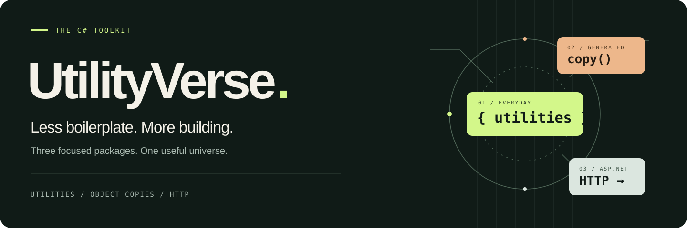

<p align="center">
  
</p>

<p align="center">
  <a href="https://github.com/purkayasta/TheUtilityVerse/actions/workflows/dotnet.yml"></a>
  <a href="https://www.nuget.org/packages/UtilityVerse/"></a>
  <a href="https://www.nuget.org/packages/UtilityVerse.Copy/"></a>
  <a href="https://www.nuget.org/packages/UtilityVerse.ASPNET/"></a>
</p>

<p align="center">
  Everyday helpers. Copies that understand your object graph. HTTP helpers for tests.<br>
  Install the package you need, then get back to your application.
</p>

<p align="center">
  <a href="#packages">Pick a package</a> ·
  <a href="#object-copying">See it work</a> ·
  <a href="#runnable-examples">Explore the examples</a> ·
  <a href="#build-and-contribute">Contribute</a>
</p>

---

## Packages

### Three tools. Three jobs.

| Package | Reach for it when… | Install |
| :--- | :--- | :--- |
| **[UtilityVerse](src/UtilityVerse/nuget.md)** | You need extensions, retries, pagination, encoding, or conversions. | `dotnet add package UtilityVerse` |
| **[UtilityVerse.Copy](src/UtilityVerse.Copy/README.md)** | Your partial C# models need generated deep or shallow copies. | `dotnet add package UtilityVerse.Copy` |
| **[UtilityVerse.ASPNET](src/UtilityVerse.ASPNET/nuget.md)** | You need HTTP request helpers for ASP.NET Core tests. | `dotnet add package UtilityVerse.ASPNET` |

**Compatibility:** Core and ASPNET ship .NET Standard 2.1 and .NET 6 / 8 / 9 / 10 / 11
assemblies. Copy targets .NET Standard 2.0 for compiler-host compatibility;
individual copy features have consumer-framework requirements documented in the
[Copy guide](src/UtilityVerse.Copy/README.md).

Shared's support assembly is bundled inside UtilityVerse. You do not install a
separate Shared package.

## Object copying

### New objects. Same relationships.

Mark a partial model with `[DeepCopy]`, then call the generated method. Even a
self-reference points to the new object after copying.

```csharp
using System;
using UtilityVerse.Copy;

var original = new Node { Name = "root" };
original.Next = original;

var copy = original.DeepCopy();

Console.WriteLine(ReferenceEquals(original, copy));  // False
Console.WriteLine(ReferenceEquals(copy, copy.Next)); // True

[DeepCopy]
public partial class Node
{
    public string Name { get; set; } = "";

    public Node? Next { get; set; }
}
```

| Deep copy | Shallow copy |
| :--- | :--- |
| `[DeepCopy]` or `IDeepCopy` → `DeepCopy()` | `[ShallowCopy]` or `IShallowCopy` → `ShallowCopy()` |
| Copies supported mutable state, preserving aliases and cycles. | Copies the object while sharing its reference fields, including arrays. |

Lists, dictionaries, queues, and stacks are supported within the documented
type constraints. Queues keep FIFO order; stacks keep LIFO order.

> **A deliberate boundary:** Deep copies default to **5 graph levels**, with the
> root at level 1. Use `[DeepCopy(depth: 10)]` or `[CopyDepth(10)]` with `IDeepCopy`
> to choose 1–100. Invalid configuration warns and falls back to 5. Unsupported
> shapes produce diagnostics; runtime depth and execution-stack guards can stop
> an unsafe copy.

**[Explore supported models, copy policies, and diagnostics →](src/UtilityVerse.Copy/README.md)**

## Everyday helpers

### Keep the small things small.

Extensions live in `UtilityVerse.Extensions`; static helpers live on
`UtilityVerse.Utility`. Helpers that use the result convention expose `Result`,
`HasError`, and `Error` so callers can handle failures explicitly.

```csharp
using System;
using UtilityVerse.Extensions;

var result = new[] { 10, 20, 30 }.ToStr(", ");

Console.WriteLine(result.HasError ? result.Error : result.Result);
// 10, 20, 30
```

**[Browse the core guide →](src/UtilityVerse/nuget.md)** ·
[Read the migration notes](src/UtilityVerse/breaking-changes.md)

## Runnable examples

### Start with code you can run.

Each published package includes an `examples.md` with complete C# programs.
XML documentation ships beside its assemblies for IDEs and coding tools.
Package verification compiles and runs those examples against freshly installed
packages on .NET 8 and .NET 11.

| Everyday work | Object graphs | HTTP tests |
| :--- | :--- | :--- |
| [Strings, collections, dates, JSON, retries, and pagination](src/UtilityVerse/examples.md) | [Copy modes, cycles, containers, policies, and depth](src/UtilityVerse.Copy/examples.md) | [Build HTTP requests for tests](src/UtilityVerse.ASPNET/examples.md) |

Working on result types? See the [Shared repository examples](src/UtilityVerse.Shared/examples.md).

## Build and contribute

### Make the toolkit more useful.

Repository development uses **.NET SDK 11.0.100**, selected by `global.json`.

```sh
./scripts/build.sh
bash scripts/verify-packages.sh
```

The build script cleans outputs, formats changed C# files, restores, builds, and
tests. On Windows, use `scripts/build.ps1`. Package verification checks Release
packages, fresh consumers, bundled Shared assemblies, examples, and Copy diagnostics.

Discuss a contribution in an issue, branch from `development`, and target your PR
at `development`. Publishing runs from `master` through NuGet Trusted Publishing;
only new package versions are uploaded.

**[Contribution and publishing guide →](CONTRIBUTING.md)**

---

<p align="center"><sub>UtilityVerse · Less boilerplate. More building.</sub></p>
