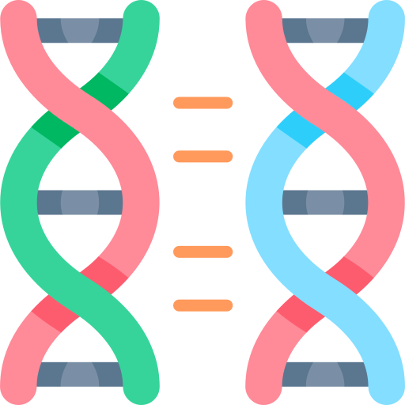

# UtilityVerse.Copy



[](https://www.nuget.org/packages/UtilityVerse.Copy/) [](https://www.nuget.org/packages/UtilityVerse.Copy/#statistics-body-tab)

Generate typed `DeepCopy()` and `ShallowCopy()` methods for partial C# classes,
records, structs, and record structs. Deep copies preserve shared references and
mutable cycles. Shallow copies share reference fields.

[Quick start](#quick-start) · [Choose a copy mode](#choose-a-copy-mode) ·
[Depth and stack safety](#depth-and-stack-safety) · [Supported types](#supported-types) ·
[Member policies](#member-policies-and-external-copiers) ·
[Diagnostics](#unsupported-shapes-and-diagnostics) · [Reference](#advanced-reference)

For complete runnable use cases, see [examples.md](examples.md), included at the
package root alongside this guide.

## Quick start

```sh
dotnet add package UtilityVerse.Copy
```

Requires Roslyn 4.11+ through .NET SDK 8.0.400+ or Visual Studio 2022 17.11+.
The package targets .NET Standard 2.0. Keep its runtime reference when distributing
consumers, since generated methods use `CopyContext` from the package.

```csharp
using UtilityVerse.Copy;

var source = new Node { Name = "original" };
source.Next = source;

var copy = source.DeepCopy();
// copy is independent, and copy.Next points to copy.

[DeepCopy]
public partial class Node
{
    public string? Name { get; set; }
    public Node? Next { get; set; }
    public List<Node> Children { get; } = new();
}
```

Use `partial` on the model and any containing types. Public, internal, nested,
and generic models are supported. Mutable child models also need deep-copy support.

## Why Copy targets .NET Standard 2.0

The same assembly supplies the generator, analyzer, and runtime copy context.
The compiler and IDE must be able to load that assembly while building a consumer.
Targeting .NET Standard 2.0 preserves compatibility with compiler hosts based on
.NET Framework, which supports .NET Standard up to 2.0. Raising this target to 2.1
would narrow compiler-host compatibility. The consumer's project target determines
which framework-specific generated features are available.

Microsoft documents the generator assembly model and the .NET Standard support
matrix. [Source generators](https://devblogs.microsoft.com/dotnet/introducing-c-source-generators/) ·
[.NET Standard compatibility](https://learn.microsoft.com/en-us/dotnet/standard/net-standard)

<a id="shallow-copy-contract"></a>

## Choose a copy mode

| Mode | Attribute | Marker interface | Result |
| --- | --- | --- | --- |
| Deep | `[DeepCopy]` | `IDeepCopy` | Copies supported stored state and mutable children while preserving graph identity. |
| Shallow | `[ShallowCopy]` | `IShallowCopy` | Creates an outer value or instance and shares every reference field, including arrays. |

Request both modes to generate both methods. Each mode is validated independently.
Shallow copying needs no nested opt-ins. Classes and records use `MemberwiseClone()`.
Structs and record structs return a value copy.

```csharp
public partial class Order : IDeepCopy, IShallowCopy
{
    public List<string> Tags { get; set; } = new();
}
```

## Depth and stack safety

The default limit is **5 levels**. The root is **level 1**. Valid settings are
**1 through 100**, and the root's setting governs the whole copy.

```csharp
// Attribute opt-in with an explicit limit.
[DeepCopy(depth: 10)]
public partial class Tree
{
    public Tree? Child { get; set; }
}

// Interface opt-in with an explicit limit.
[CopyDepth(10)]
public partial class Document : IDeepCopy
{
    public Document? Child { get; set; }
}
```

`[DeepCopy]` and `IDeepCopy` both use 5 automatically. Each newly copied model or
container adds one level. Scalars, nulls, shared immutable values, and references
already copied use no extra level.

| Graph | Required depth |
| --- | --- |
| Root with scalar state or a self-reference | 1 |
| Root → child model | 2 |
| Root → list or stack → model element | 3 |

Nested settings apply when that model becomes an independent root. Configuration
is non-inherited. `DeepCopy` takes precedence when both configuration attributes
appear. Invalid values produce [UV006](#uv006) and fall back to 5.

Exceeding the budget throws `NotSupportedException` with the limit and attempted
level. The context clears partial copy state. Suppressing a nested failure still
causes the enclosing copy to fail. Generated methods, direct interface calls, and
`CopyContext.Copy` follow the same budget. Manual copiers can implement
`ICopyDepthConfiguration` to supply a root budget in the same range.

The runtime also checks available execution-stack space periodically and bounds
internal copy operations. A higher configured depth can still fail when available
stack space is insufficient. Internal forwarding calls and base constructors use
the graph's current level.

The generator and analyzer have an independent **100-level type-traversal guard**.
Excessive type nesting produces [UV004](#uv004). Ordinary recursive models remain
supported. Custom callbacks must bound recursion outside context copy entry points.

**Upgrading consumers** — graphs deeper than 5 need an explicit limit and rebuilt
generated code. Earlier shallow copies cloned array containers. Arrays now share
their references alongside other shallow-copied state.

## Supported types

| Category | Supported state |
| --- | --- |
| Models | Opted-in classes, records, structs, record structs, and supported inheritance. |
| Scalars | Primitives, enums, strings, nullable values, built-in immutable values, exact `Uri`, and `Version`. |
| Arrays | Vectors, jagged and multidimensional arrays, with runtime type, lengths, and bounds preserved. |
| Sequences | `List<T>`, `LinkedList<T>`, `Queue<T>`, `Stack<T>`, supported collection wrappers, and enumerable interfaces. |
| Sets and maps | Hash and sorted sets, dictionaries, sorted maps, and supported concurrent dictionary targets. Comparers are retained. |
| Immutable collections | Supported immutable and frozen collections with the key and element restrictions below. |
| Tuples | Reference tuples and value tuples with recursively copied mutable children. |

### Stacks and queues

`Stack<T>` copies preserve **LIFO** order. `Queue<T>` copies preserve **FIFO** order.
The destination container is independent, and mutable model elements are copied
within the root's depth budget. Aliases and supported cycles remain shared within
the copied graph.

```csharp
[DeepCopy]
public partial class WorkQueue
{
    public Stack<Node> Undo { get; set; } = new();
    public Queue<Node> Pending { get; set; } = new();
}
```

With the `Node` model from the quick start, `WorkQueue` is level 1, either
container is level 2, and a new `Node` element is level 3. Its own `Children` list
occupies level 4.

<details>
<summary>Full collection support and restrictions</summary>

- Primitive values, enums, strings, immutable built-in values, nullable values,
  `Uri`, and `Version`. Only an exact `Uri` instance can be shared as immutable.
  A runtime subclass needs an `IDeepCopyable` implementation or copying throws
  `NotSupportedException`. A struct containing a `Uri` member needs a deep copy
  opt-in so the copier checks the member's runtime type. Rebuild previously
  generated consumers to replace assignments that shared `Uri` members directly.
- Arrays of any rank, including jagged arrays, nullable elements, and nonzero
  lower bounds. Copies keep the runtime array type, lengths, and bounds.
- `List<T>`, `LinkedList<T>`, `HashSet<T>`, `SortedSet<T>`, `Queue<T>`,
  `Stack<T>`, `Collection<T>`,
  `ReadOnlyCollection<T>`, `ObservableCollection<T>`, and `BindingList<T>`.
  Binding lists preserve `AllowEdit`, `AllowRemove`, `RaiseListChangedEvents`,
  and the current `AllowNew` value. Copies start with fresh change-notification
  wiring and a clean add-new transaction state. Reattach external subscribers to
  the copy, including any `AddingNew` handler that supplied new items.
- `IEnumerable<T>`, `IList<T>`, `ICollection<T>`, `IReadOnlyList<T>`, and
  `IReadOnlyCollection<T>`. Recognized runtime collection types are preserved;
  other enumerable sequences are materialized into lists. Unsupported collection
  subclasses are rejected rather than losing their additional state.
- `Dictionary<TKey,TValue>`, `SortedDictionary<TKey,TValue>`,
  `SortedList<TKey,TValue>`, and `ConcurrentDictionary<TKey,TValue>` on
  frameworks exposing its public `Comparer`. `IDictionary<TKey,TValue>` and
  `IReadOnlyDictionary<TKey,TValue>` views preserve these concrete types. An
  interface view can copy a concurrent dictionary when the declared key type
  satisfies the concurrent dictionary's nonnullable key constraint.
  Dictionary and set comparers are retained.
  Generated copies throw `NotSupportedException` for runtime subclasses of these
  maps. A custom `CopyContext.CopyMap` factory can handle a subclass by returning
  the same runtime type and preserving its additional state.
- Reference tuples and value tuples; their mutable children are copied recursively.
- `ImmutableList<T>`, `ImmutableHashSet<T>`, `ImmutableSortedSet<T>`,
  `ImmutableDictionary<TKey,TValue>`, `ImmutableSortedDictionary<TKey,TValue>`,
  `FrozenDictionary<TKey,TValue>`, and `FrozenSet<T>`. Immutable and frozen maps
  and sets require immutable scalar keys or elements. Map values and immutable list
  items can be mutable and are copied recursively. `ImmutableArray<T>` with
  immutable scalar elements shares its immutable backing.
- Nested collections and opted-in mutable structs. A struct containing mutable
  references must opt in; it is never silently treated as an immutable value.

</details>

## Member policies and external copiers

| Policy | Behavior |
| --- | --- |
| `Copy` | Default behavior for supported stored state. |
| `Share` | Retains the source value or reference. |
| `Reset` | Assigns the member type's default value. |
| `Custom` | Invokes an external copier registered for the exact runtime type. |

```csharp
[DeepCopy]
public partial class Session
{
    [CopyPolicy(CopyBehavior.Share)]
    public System.IO.Stream? Stream { get; set; }

    [CopyPolicy(CopyBehavior.Reset)]
    public Action? Callback { get; set; }
}
```

<details>
<summary>External copier registration and ownership rules</summary>

Apply `[CopyPolicy(CopyBehavior.Share)]` to keep a reference such as a stream or
shared lock. `Reset` assigns the type's default value, which can clear a callback
or release the destination's reference to a source-owned resource.
`Copy` is the default. `Custom` uses a copier registered with
`CopyContext.RegisterExternalCopier<T>()` for the value's exact runtime type.
Apply the policy to a stored property or field. An auto-property can also receive
the attribute on its backing field using the `field:` target.

An external copier returns a new instance of the same runtime type. It can call
`context.Register(source, destination)` before copying child references to
preserve cycles. Register each supported subtype separately. Boxed external
structs preserve completed aliases and reject cycles that require creating the
destination box before the copier returns. Keep the same policy on members that
should point to the same copied object. Ref-like and pointer state still requires
a custom model-level implementation.

</details>

## Unsupported shapes and diagnostics

The analyzer applies the same rules to attribute and interface opt-ins. Follow the
message at the highlighted declaration or member, then rebuild the affected project.

| ID | Severity | Fix |
| --- | --- | --- |
| [UV001](#uv001) | Error | Add `partial` to the highlighted type. |
| [UV002](#uv002) | Error | Opt the stored value's type into deep copying or select a suitable member policy. |
| UV003 | Reserved | Shallow references need no nested opt-in. |
| [UV004](#uv004) | Error | Resolve the unsupported shape or excessive compiler traversal described in the message. |
| [UV005](#uv005) | Warning | Remove or relocate a copy policy that has no effect. |
| [UV006](#uv006) | Warning | Use depth 1–100 and remove ignored configuration. |

### UV001

Add `partial` to the declaration highlighted by the diagnostic. Keep the
attribute or marker interface already on the type. For example,
`public class Order : IDeepCopy` becomes `public partial class Order : IDeepCopy`.
The diagnostic names the methods this enables.

### UV002

Start at the highlighted field or property. The message also names the type
that needs support, which can be an array element, collection element,
dictionary key or value, or tuple member. The analyzer includes a related
location when that declaration is available in the same compilation.

If you own a supported class or struct, make it partial and opt it in with
`[DeepCopy]` or `IDeepCopy`. For an external type that needs its own copy,
apply `[CopyPolicy(CopyBehavior.Custom)]` to the stored member and register a
copier for the member value's exact runtime type. For a collection member, that
means registering a copier for the collection itself. Use `Share` only when
retaining the same reference is intentional. Use `Reset` only when assigning
the type's default value is intentional. See
[member policies and external copiers](#member-policies-and-external-copiers).

### UV004

Use the reason in the diagnostic to choose the fix. It identifies the blocked
declaration or member and explains what the generator needs. Common cases include

- File-local models, models nested in file-local types, non-partial containing
  types, static/ref-like types, and declarations that
  conflict with emitted members. A field, property, event, or nested type named
  `DeepCopy` or `ShallowCopy` conflicts with the corresponding generated method.
  Methods with distinct signatures, such as `DeepCopy<T>()`, can coexist.
- Primary constructors with unmatched or potentially mutable arguments,
  primary constructors requiring generated base copying, custom record copy
  constructors, captured primary-constructor state, and event subscriptions.
- Non-opted-in base classes with no accessible parameterless constructor.
- Inaccessible, hidden, or readonly inherited state when the base type has no deep opt-in; external bases must provide the current graph-copy support.
- Stored-property override chains requiring field access unavailable on the
  consumer framework, legacy external bases without physical-storage capability,
  or inaccessible nested owners that cannot host a safe generated helper.
- Explicit-interface auto-properties in deep-copy models. Implement the property
  with an ordinary backing field or supply a custom deep copier.
- Pointer state, unsupported immutable or frozen collection implementations,
  and mutable keys in immutable or frozen maps and sets.

When the existing shape and semantics are intentional, implement the copy
explicitly. Cycles through immutable reference tuples and immutable or frozen collections throw
`NotSupportedException`. Mutable object cycles are supported.
Keys and set elements must retain stable hash/equality behavior on the completed
graph, just as they must in the original collection. Copies are snapshots of a quiescent graph;
concurrent mutation during copying is not synchronized.

### UV005

The warning identifies the policy and highlights its attribute. Remove the
policy if the model is intended to stay shallow. If the copy needs member-specific
behavior, opt in to deep copying and call `DeepCopy()`. For a computed, static,
or other non-stored member, remove the attribute or move it to the instance
field or auto-property that owns the value.

### Using diagnostics with coding agents

Give the agent the diagnostic ID, its full message, and the source location.
Use the related declaration for `UV002` when the editor includes it. Ask the
agent to apply the smallest source change that preserves the intended copy
behavior. Before choosing `Share`, `Reset`, or shallow copying, confirm which
references must remain shared and which must be copied. Rebuild the affected
project and check that the diagnostic clears.

For machine-readable input, the C# compiler can write the same diagnostics and
their rule help links to a SARIF file. Run this for the affected project and
select one target framework with `-f` if needed.

```sh
dotnet build -p:ErrorLog=copy-diagnostics.sarif
```

### UV006

Depth configuration must be an integer from 1 through 100. Negative values, zero,
and larger values produce a warning and use the default of 5. Set a valid value
on `[DeepCopy(depth: 10)]` or `[CopyDepth(10)]`. Remove redundant `CopyDepth` when
`DeepCopy` is present, or add a deep-copy opt-in when `CopyDepth` has no effect.

<a id="deep-copy-contract"></a>

## Advanced reference

<details>
<summary>Stored state, constructors, and inheritance</summary>

Generated constructors copy stored instance fields and auto-properties, including
private fields, readonly fields, init-only properties, and stored getter-only
properties. Computed properties are derived from that copied state. Static state
is ignored. Ordinary classes bypass their own existing constructors: the generated
copy constructor registers the destination and hydrates its stored state directly.
Constructor parameter names do not need to match state members. Field initializers
and parameterless constructors on non-opted-in base classes can still run; copying
does not suppress arbitrary side effects in that code.

A primary constructor must run under C# constructor-chaining rules. Its
arguments must match stored fields or auto-properties and contain only immutable
values with no mutable references, including references nested in structs. An ordinary
class primary constructor cannot be combined with a generated base copy constructor.
A non-positional derived record can chain to an opted-in base's generated constructor
and preserve its private and readonly state. Its own field initializers can run.
Other supported reference records use a chain of compiler-synthesized record copy
constructors and hydrate accessible inherited state. Positional records that need
inaccessible inherited state, custom record copy constructors, and unverified
external record-copy chains receive `UV004`.
Structs without primary constructors initialize through `this()` before hydrating
state. An explicitly declared parameterless struct constructor can run.

</details>

<details>
<summary>Overridden properties and framework requirements</summary>

Overridden auto-properties preserve each declaring class's independent backing
storage through generated typed `UnsafeAccessor` field methods. Copying bypasses
virtual getters and setters, including computed overrides, and supports readonly,
getter-only, init-only, and shared or cyclic reference state.

The field-access backend requires .NET 8+ for non-generic declaring types and .NET
9+ for generic declaring types, including generic enclosing types. The generator
and runtime package still target netstandard2.0 and use Roslyn 4.11. Older consumers
retain ordinary copy support; shapes requiring unsupported physical field access
receive `UV004` rather than an inaccurate copy. Generic helpers preserve parameter
order and constraints, even when the derived type's parameters differ from the base.

Opted-in bases distributed in another assembly must be rebuilt with this field
backend for their applicable target. Generated copy constructors record a physical
storage capability marker; legacy bases without it receive `UV004` when an override
would otherwise lose stored state. Private/protected nested owners or property types use helpers in
partial owning/enclosing types; inaccessible storage whose owners cannot host a
safe helper (including shadowed enclosing generic parameter names) are diagnosed.

An explicit backing field remains a portable alternative on older targets.
Overrides of abstract properties need no base storage access. Shallow copies use
`MemberwiseClone` and preserve both backing fields on all supported targets. No
runtime model-member reflection or dynamically emitted code is used.

</details>

<details>
<summary>Graph completion, dictionary keys, and failure recovery</summary>

Dictionary entries and hash-set elements are copied into typed temporary buffers.
Their destination containers are registered immediately, preserving cycles and
aliases, but insertion waits until the outermost graph operation has hydrated
object state. This allows a key's hash or equality to depend on its owner's copied
fields, including fields declared after the collection.

Once every pending container is populated, standard dictionary and set lookups are
checked. Containers with invalid buckets are rebuilt in place once, preserving
their identity and comparer, then checked again. Hash/equality dependencies that
remain unstable throw `NotSupportedException`; duplicate copied keys or elements
also throw rather than being discarded. This is not a general dependency solver
for arbitrary comparers. Hash/equality implementations must be side-effect-free
and stable on the completed graph; custom copy callbacks must not depend on pending
containers already being populated during hydration.

All public `CopyContext` copy entry points and generated `IDeepCopyable.Copy` calls
complete pending work before the outermost call returns. Generated implementations
use `CopyGenerated<T>(T, Func<T, CopyContext, object>)` to establish that boundary
even when called through the interface directly. Existing context entry-point
signatures remain unchanged. If an operation fails, cached destinations and pending
work are cleared so the context cannot return partial copies on a later call. A
custom copier must propagate nested failures; suppressing one still causes the
enclosing operation to fail.

</details>

<details>
<summary>Collection views, backing stores, and runtime registration</summary>

Covariant sequence views preserve the exact supported runtime container and its
actual element type. For example, a `List<Derived>` shared by `IEnumerable<Base>`
and `List<Derived>` members produces one `List<Derived>` copy in either traversal
order. This also applies to empty and null-only collections, nested sequences,
queue/stack order, and set comparers. `IEnumerable<T>` describes enumeration only;
construction and insertion still use typed adapters for each supported container.

Collection wrappers are copied as standalone snapshots when their public
`ICollection.SyncRoot` identifies a supported list or array. A graph that copies
both a wrapper and its backing store, or distinct wrappers sharing one backing
store, throws `NotSupportedException`. Mutable wrappers with read-only or
fixed-size backing and wrappers with opaque synchronization roots also require a
custom copier. This includes frameworks that expose an opaque synchronization
root for their standard list implementation.

Generated code registers declared sequence element types across the model's
inheritance hierarchy, plus accessible non-generic opted-in source models assignable
to those element views. Immutable reference scalars (`string`, `Uri`, `Version`)
are registered by the runtime. When an actual element type cannot be determined
from that source context (for example, an external subtype or a closed generic
subtype visible only through a base view), register it before copying:

```csharp
CopyContext.RegisterSequenceType<ExternalDerived>();

var copy = model.DeepCopy();
```

Direct `CopyContext.CopySequence` callers use the same registration API. A known
container with an unregistered actual element type throws `NotSupportedException`,
including when empty; it never silently changes that type. Registered adapters
honor the caller's element-copy delegate. The delegate must return values assignable
to the actual element type. Registration does not make an unsupported model or
custom collection implementation copyable. Collection type metadata is inspected
once per runtime container type and cached weakly; copying uses statically compiled
generic methods, without model-member reflection or dynamic code generation.

Generic type parameters can contain immutable scalars, `IDeepCopyable` values,
and supported runtime sequences such as `List<int>`. Members declared as
`System.Array` use the same runtime element dispatch. Common scalar element
types and `object` are registered automatically. Generated code also registers
visible opted-in model types for these runtime views. Use
`CopyContext.RegisterSequenceType<T>()` for other element types, including
closed generic or nested array types that the generator cannot discover.
Unsupported runtime values throw `NotSupportedException`.
There is no reflection over model members;
generated typed assignments perform the copy, with a small runtime context from
this package and no external runtime dependencies. Keep the package's runtime
reference when distributing consumers.

</details>

<details>
<summary>Boxed struct identity and cycles</summary>

When a graph passes an opted-in struct through an object or interface reference,
repeated references to the same box share one destination box. Separate boxes
remain separate even if their values are equal. Use `CopyContext.Copy(boxedValue)`
to copy a boxed root so the context receives its original reference. Calling
`IDeepCopyable.Copy` directly on a struct copies its value.

Preserving cycles through a box requires generated code compiled against a
framework that exposes `Unsafe.Unbox<T>`. The copier registers the new box before
copying its children, then writes the copied value into it. Older generated
copiers and targets without that API preserve acyclic box aliases and throw
`NotSupportedException` when a box is revisited before its copy is ready.

</details>

## Validation

The repository uses .NET SDK 11.0.100 with compatible patch roll-forward.
Run these commands from the repository root.

```sh
./scripts/build.sh
dotnet run --project tests/UtilityVerse.Copy.Test
bash scripts/verify-packages.sh
```

The build workflow cleans outputs, formats changed C# files, restores, builds, and
runs the tests. Windows contributors can use `scripts/build.ps1`. Copy tests cover
generated compilation, analyzer diagnostics, graph behavior, depth limits, and
older consumer references. Package verification runs fresh installed consumers, including cycles and depth
configuration. CI runs package
verification as well.
