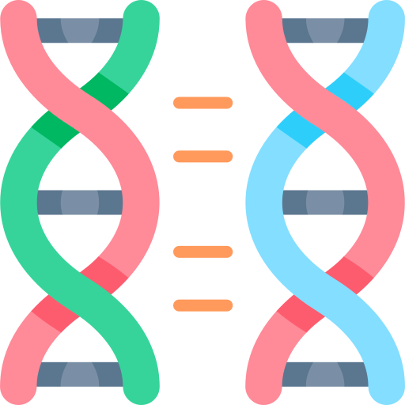

# UtilityVerse.Copy



[](https://www.nuget.org/packages/UtilityVerse.Copy/) [](https://www.nuget.org/packages/UtilityVerse.Copy/#statistics-body-tab)

Generate `DeepCopy()` and `ShallowCopy()` methods for partial C# classes, records,
structs, and record structs. Opt in with attributes or empty marker interfaces.

## Get started

```sh
dotnet add package UtilityVerse.Copy
```

```csharp
using UtilityVerse.Copy;

[DeepCopy]
public partial class Node
{
    public string? Name { get; set; }
    public Node? Next { get; set; }
}

// Call source.DeepCopy() to copy the graph.
```

Use `[ShallowCopy]` for an outer copy that shares references. Request both modes
to generate both methods. Interface consumers can use `IDeepCopy` and `IShallowCopy`.

## Depth and stack safety

Depth defaults to **5**, with the root at **level 1**. Each new model or container
adds one level. Scalars, nulls, and already-copied references add no level.

- Attribute configuration uses `[DeepCopy(depth: 10)]`.
- Interface configuration uses `[CopyDepth(10)]` with `IDeepCopy`.
- Valid values are **1–100**. Invalid values produce **UV006** and use 5.
- The root's budget applies to the entire operation. Exceeding it throws
  `NotSupportedException` and clears partial copy state.

Execution-stack checks and internal-operation limits remain active. Raising the
depth limit still depends on available stack space. An independent 100-level
compiler traversal guard reports excessive type nesting through **UV004**.
Existing consumers copying deeper graphs need explicit configuration and rebuilt
generated code.

## What it copies

Deep copies preserve supported stored fields and auto-properties, shared reference
identity, mutable cycles, runtime derived types, and collection comparers.
Arrays, lists, dictionaries, tuples, queues, stacks, and selected immutable and
frozen collections are supported. `Stack<T>` preserves LIFO order, and `Queue<T>`
preserves FIFO order. Member policies can share, reset, or use an external copier.

The compiler reports unsupported declarations and stored shapes. Some runtime
values also require registration or a custom copier. The full guide documents
collection restrictions, inheritance, framework requirements, and diagnostic fixes.
[Read the Copy guide](https://github.com/purkayasta/TheUtilityVerse/blob/development/src/UtilityVerse.Copy/README.md)

## Requirements

Requires Roslyn **4.11+**, available with .NET SDK **8.0.400+** or Visual Studio
**2022 17.11+**. The package targets **.NET Standard 2.0** and supplies the runtime
graph context used by generated code. Retain its runtime package reference.
Copying uses typed generated assignments without runtime model-member reflection
or external runtime dependencies.

## Runnable examples

The package includes `examples.md` at its root with complete programs and expected
behavior for consumers and coding agents.
[Browse examples](https://github.com/purkayasta/TheUtilityVerse/blob/development/src/UtilityVerse.Copy/examples.md)

### Why .NET Standard 2.0?

The generator runs inside compiler and IDE hosts. A .NET Standard 2.0 target keeps
it loadable by compatible .NET Framework hosts. The consumer project can target
modern .NET. Feature-specific generated code follows the consumer's available APIs.
